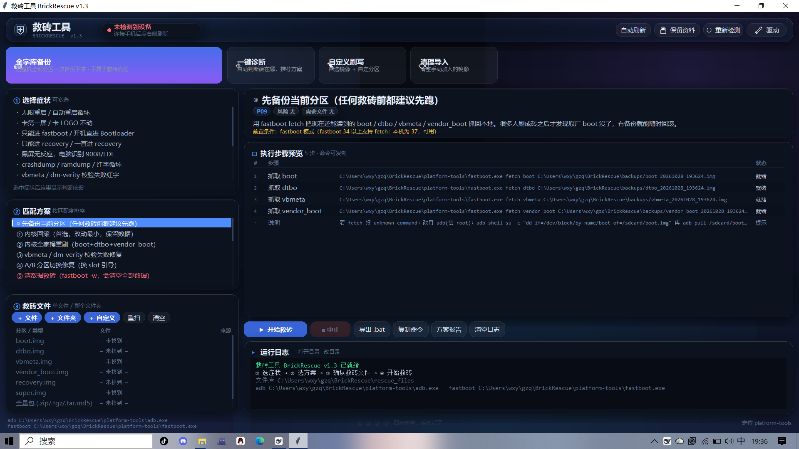

# 救砖工具 BrickRescue

> 安卓手机刷内核变砖（无限重启、卡第一屏、只能进 fastboot / recovery、黑屏 9008）的一体化救砖台。
> **选症状 → 自动列出匹配方案 → 绑定救砖文件 → 预检 → 一键执行**，每条命令执行前都能预览，全程落盘日志。



Windows 10 / 11 · 单文件 Python · 内置 adb/fastboot 便携版 · 不需要装任何东西

---

## 它解决什么问题

刷了不匹配的内核、刷错槽位、vbmeta 校验炸了、OTA 半途断电、乱进 recovery 出不来 —— 这时候网上的教程通常是一堆零散的 `fastboot flash` 命令，抄错一个分区就二次变砖。

BrickRescue 把这些场景收敛成 **18 套方案**，按你选的症状自动排序，每条命令在真正下发前先过一遍预检（设备在不在 fastboot、BL 有没有解锁、文件齐不齐、这条命令会不会清数据）。

## 功能

**18 套救砖方案**

| 方案 | 用途 |
|---|---|
| P09 先备份 | 救砖前必跑，用 `fastboot fetch` 把原分区抓回来 |
| P01 内核回滚 | 只刷 boot，保留数据；刷内核变砖的第一手 |
| P02 内核全家桶 | boot + dtbo + vendor_boot 一起刷 |
| P03 vbmeta 校验修复 | 治 dm-verity 红字、橙色警告 |
| P04 A/B 换槽引导 | `set_active` 切到另一个槽 |
| P05 清数据救砖 | `fastboot -w`（高风险，见「保留资料模式」） |
| P06 侧载全量包 | recovery 里 `adb sideload` |
| P07 EDL 9008 指引 | 生成操作指引，讲清 QFIL 怎么走 |
| P08 fastboot 无响应 | 重启服务、换口、查驱动 |
| P10 全量线刷 | 生成整包刷写脚本 |
| P11 刷回官方 recovery | 治「一直进 recovery」 |
| P12 只读诊断 | 只读，不改任何东西 |
| P13 目录批量回刷 | 目录里每个 `分区名.img` 逐个刷回 |
| P14 全量包直刷 | `fastboot update` |
| P15 按官方脚本刷写 | 解析 `flash_all.bat` 逐条执行 |
| P16 自定义刷写 | 自选镜像 + 自填分区名 + 选槽位 |
| P17 全字库备份 | 整机分区全备 + 生成 `restore_all.bat` |
| P18 一键识别问题 | 自动采集 + 规则判定 + 推荐下一个该点哪个方案 |

**横切能力**

- 🔒 **保留资料模式**：勾上后，`-w` / `erase userdata` / `flash metadata` 这类命令被标成「⛔拦下」不执行，P05/P10/P14 直接置灰
- 🔧 **驱动面板**：扫描 Android/ADB/QDLoader 设备、一键装 Google USB Driver、从本地 `.inf` 安装、重启 adb
- 🧪 **预检闸门**：设备状态 / BL 解锁 / 文件校验 / 方案风险，全过才真正下发
- 📄 **方案可导出**：每套方案能导出成独立 `.bat`，脱离本工具也能跑
- 🎨 **自绘液态玻璃 UI**：Canvas 手绘磨砂卡片、渐变、圆角发光按钮，缩放不错位

## 快速开始

### 方式一：便携版（推荐给只想救砖的人）

下载 Release 里的 `BrickRescue_v1.3_portable.zip`，解压到任意目录，双击 **`启动救砖工具.bat`**。
不用装 Python，不用装 adb。

> 便携版自带 `runtime/`（Python 3.14 + tkinter）和 `platform-tools/`（adb/fastboot）。
> 这两个目录**没有**放进本仓库，见下方「获取依赖」。想自己打包就下载 [Python embeddable 3.14](https://www.python.org/downloads/windows/) 与 [SDK Platform-Tools](https://developer.android.com/tools/releases/platform-tools)，解压覆盖即可。

### 方式二：源码运行（想改的人）

```powershell
git clone https://github.com/gu-yue7/BrickRescue.git
cd BrickRescue
python -m pip install pillow      # 液态玻璃 UI 需要 Pillow，其余全是标准库
python brick_rescue.py            # 图形界面
python brick_rescue.py --cli      # 命令行交互
python brick_rescue.py --list     # 列出症状与方案
python brick_rescue.py --dry-run P01   # 只渲染命令不执行
python brick_rescue.py --selftest      # 不接触设备的自检
```

要求 Python 3.9+（`tkinter` 随官方 Windows 安装包自带）。

## 目录结构

```
BrickRescue/
├── brick_rescue.py       主程序，单文件
├── 启动救砖工具.bat       图形界面入口
├── 命令行模式.bat         无 GUI 环境用（服务器 / 精简系统）
├── 详细说明.md            完整文档：方案对照表、故障排查、命令细节
├── 使用说明.txt           便携版用户的极简说明
├── screenshot.png        界面截图
├── BrickRescue.ico       图标
├── rescue_files/         救砖文件库（骨架入库，镜像不入库）
│   ├── boot/ dtbo/ vbmeta/ vendor_boot/ recovery/ super/
│   ├── fullpackage/      全量包 zip / tgz / tar.md5
│   └── edl/              firehose prog_firehose_ddr.elf/.mbn
├── drivers/              驱动面板下载的 Google USB Driver
├── logs/                 运行日志（不入库）
├── backups/              P09 / P17 备份（不入库）
└── out/                  生成的 .bat / 方案报告 / 诊断报告（不入库）
```

## 获取依赖

| 目录 | 内容 | 获取方式 |
|---|---|---|
| `runtime/` | Python 3.14 嵌入式运行时 | python.org 的 Windows embeddable package，解压进 `runtime/` |
| `platform-tools/` | adb / fastboot（Google 官方 37.0.1） | developer.android.com 的 SDK Platform-Tools，解压进 `platform-tools/` |
| — | Pillow（UI 依赖） | `python -m pip install pillow` |

缺少 `runtime/` 时 `.bat` 会退回系统 `python`，缺少 `platform-tools/` 时工具会去 PATH 里找 `adb` / `fastboot`。

## 安全设计

刷机是不可逆操作，工具在三个位置强制刹车：

1. **预检**：选完方案点执行，先弹一张核对表 —— 设备状态、BL 解锁状态、缺哪个文件、该方案风险等级，确认才继续
2. **保留资料模式**：命中清数据命令直接拦下并在日志里标红，不是「提示后继续」
3. **好砖坏砖都能读**：P12 只读诊断只采集信息不改分区，P18 只给建议不下命令

## 免责声明

- 刷机有风险，**可能导致设备变砖、数据永久丢失、保修失效**，操作前请自行备份并确认镜像与机型的匹配性。
- 本项目按现状（AS IS）提供，不附带任何担保；因使用本工具造成的设备损坏或数据丢失由使用者自行承担。
- 各厂商固件、Google Platform-Tools 的版权与许可归各自权利人所有，本仓库不包含任何厂商固件。

## 贡献

Issue / PR 都欢迎。提交前请：

- 新方案写进 `SCENARIOS` / 方案表并补一条 `--selftest` 覆盖
- 涉及清数据的命令必须挂上 `wipes_data` 标记，否则「保留资料模式」拦不住
- 随手传一下 `python brick_rescue.py --selftest` 的输出

## License

[MIT](LICENSE)
